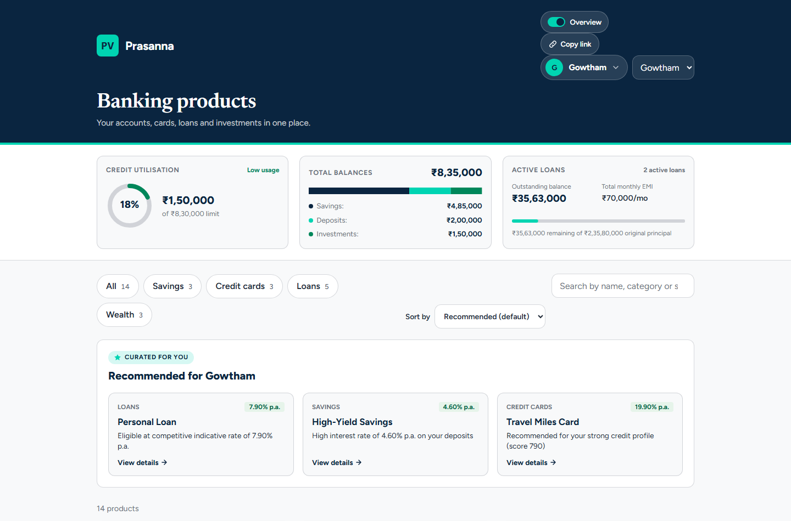
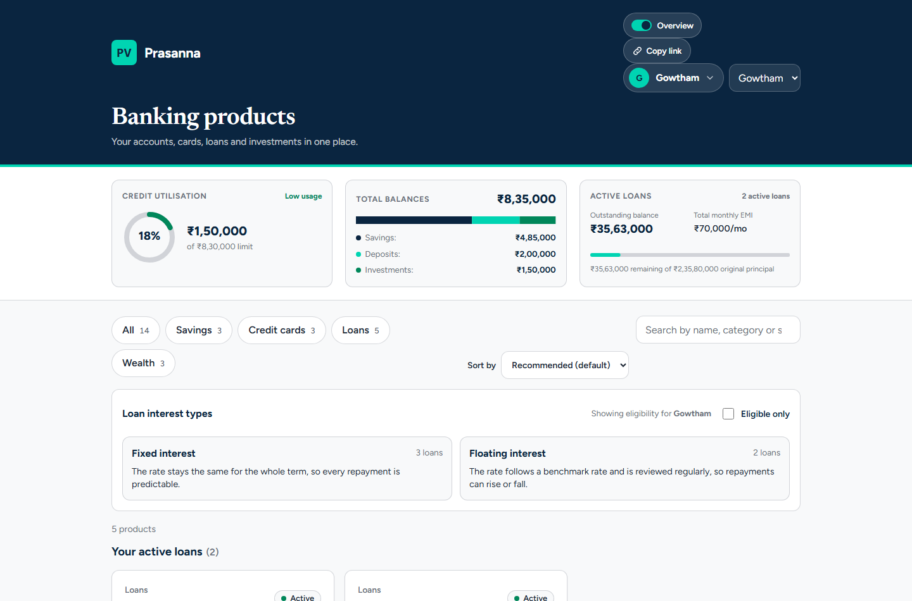
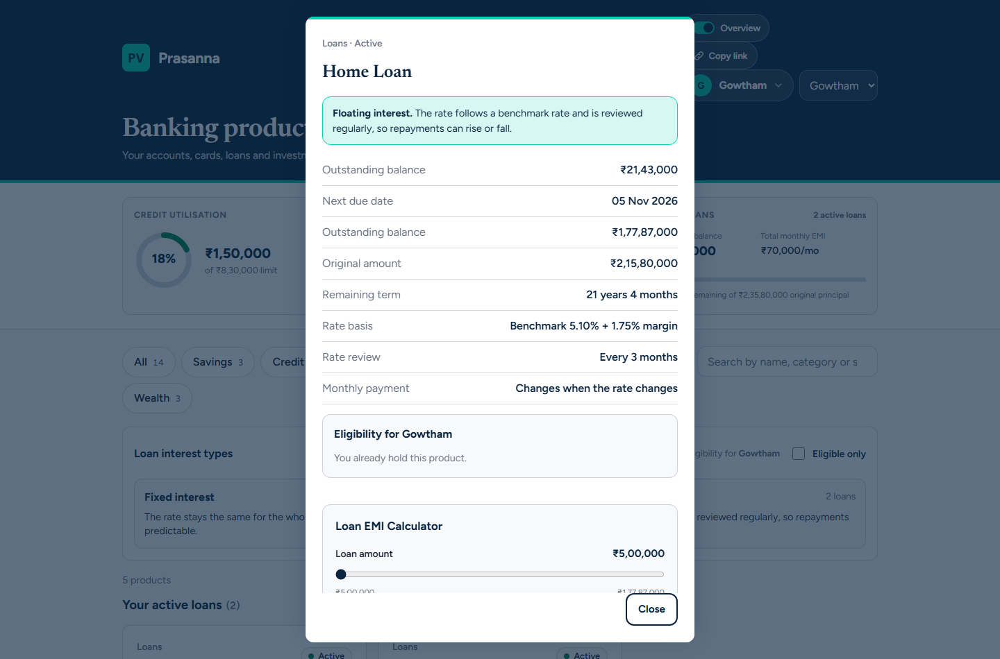
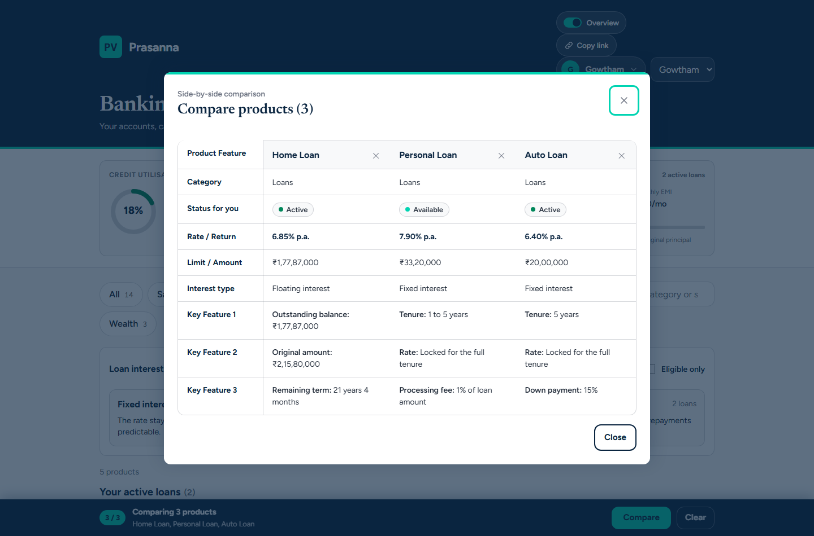
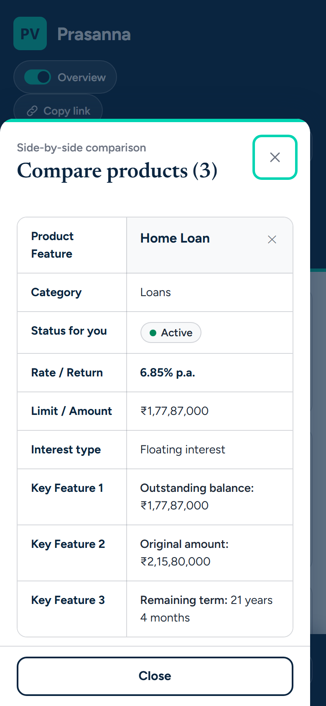
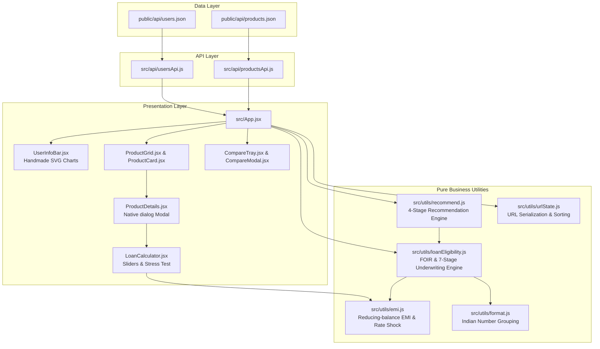

# Prasanna Banking Products Dashboard

> A high-performance, portfolio-grade Indian banking dashboard engineered with React 18 and Vite. Features reducing-balance EMI calculations with floating-rate shock stress-testing, automated FOIR underwriting with computed qualification remediation, personalized multi-product recommendations, side-by-side comparison matrices, zero-library accessible SVG telemetry, and pure URL state synchronization.

[](https://banking-products-dashboard-gamma.vercel.app/)
[](https://github.com/Prasannax14/Banking_Products_Dashboard/actions)
[](https://banking-products-dashboard-gamma.vercel.app/)
[](https://banking-products-dashboard-gamma.vercel.app/)

---

## 🚀 Live Demo

**Experience the deployed application:** [https://banking-products-dashboard-gamma.vercel.app/](https://banking-products-dashboard-gamma.vercel.app/)

- **Preset User Links:**
  - [Gowtham (Showcase User: Active, Eligible, and Ineligible loans)](https://banking-products-dashboard-gamma.vercel.app/?user=usr-001&tab=all&info=true)
  - [Kavya (Student: Education loan only, student-exclusive recommendations)](https://banking-products-dashboard-gamma.vercel.app/?user=usr-004&tab=all&info=true)
  - [Imran (KYC Pending: Complete lockout on loan and credit card products)](https://banking-products-dashboard-gamma.vercel.app/?user=usr-007&tab=all&info=true)
  - [Three-Product Side-by-Side Comparison](https://banking-products-dashboard-gamma.vercel.app/?user=usr-001&tab=all&compare=sav-001,ln-001,cc-001)

---

## 📸 Application Screenshots

### 1. Main Dashboard & Accessible Financial Telemetry (Desktop 1440px)

*Hero view featuring the Prasanna navy masthead, user profile switcher, URL copy trigger, personalized recommendations, privacy-masked SVG telemetry, and responsive product catalog.*

---

### 2. Loan Grouping & Explainable Underwriting (Active, Eligible, Ineligible)

*Tri-state grouping on the Loans tab separating currently held active loans, eligible loans with pre-approved borrowing limits, and ineligible loans with computed qualification hints.*

---

### 3. Interactive Loan EMI Calculator & Floating Rate Shock Stress-Testing

*Native modal dialog displaying reducing-balance EMI calculations, live sliders, and rate shock analysis (+0.0% to +3.0%) illustrating monthly cash outflow and total extra interest payable.*

---

### 4. Side-by-Side Multi-Product Comparison Matrix

*Comparison modal supporting up to 3 cross-category products, displaying status, interest rates, maximum limits, tenure, and detailed feature breakdowns with sticky column locking.*

---

### 5. Mobile-First Responsive Experience (390px iPhone Viewport)
<p align="center">
  
</p>
*Mobile layout featuring horizontally scrollable category tabs, stacked cards, full-width bottom sheets, and responsive telemetry bars.*

---

## ✨ Key Features

1. **Loan EMI Calculator & Rate Shock Analysis:**
   - Pure reducing-balance mathematical formula: $P \times r \times \frac{(1+r)^n}{(1+r)^n - 1}$.
   - Live interactive sliders for loan principal and tenure with formatted INR outputs (`aria-valuetext`).
   - **Floating Rate Shock Slider:** Allows borrowers to model rate increases from +0.00% to +3.00% in 0.25% increments, calculating the immediate monthly EMI increase and total excess interest paid over the loan term.
   - **Fixed-Rate Guarantee:** Fixed loans clearly display a locked-rate security badge confirming repayment stability.
   - **Non-Eligible Indicative Mode:** Clearly denotes calculations as illustrative when a user does not meet baseline underwriting rules.

2. **Explainable Underwriting & Computed "How to Qualify" Fixes:**
   - Transparent evaluation of KYC verification, minimum age, age at loan maturity, monthly income, credit score thresholds, and 50% FOIR (Fixed Obligation to Income Ratio) limits.
   - For failing criteria, provides exact dynamically computed fixes:
     - *Credit score shortfall:* `"Raise your credit score by 15 points to reach 750"`
     - *Income requirement:* `"Monthly income needs to be at least Rs 40,000"`
     - *FOIR debt capacity:* `"Reduce existing EMIs by about Rs 18,500 per month, or choose a smaller amount"` (computed using reducing-balance formula against the minimum borrowing amount).
     - *KYC Pending:* `"Complete your KYC verification"`

3. **Multi-Product Recommendation Engine (`recommend.js`):**
   - Prioritized 4-tier recommendation logic:
     1. Eligible loan with the lowest indicative rate (Student loans restricted exclusively to students).
     2. Highest-yielding unheld savings account based on numeric sorting rate.
     3. Pre-qualified credit card (strictly requiring KYC Verified and credit score $\ge 700$).
     4. First unheld wealth product.
   - KYC Pending users receive zero loan/card recommendations and an actionable KYC completion notice.

4. **Bi-Directional Pure URL State Synchronization (`urlState.js`):**
   - Deep-linking without external router dependencies: encodes `user`, `tab`, `q`, `interest`, `eligible`, `sort`, `compare` (comma-separated IDs), and `info` (telemetry open/close).
   - Debounced search synchronization (300ms) with `history.replaceState`.
   - Complete input sanitization and fallback to defaults on invalid inputs.
   - One-click "Copy link" button with live screen reader confirmation via `aria-live`.

5. **Side-by-Side Product Comparison:**
   - Dedicated comparison checkbox on every product card.
   - Strict 3-item ceiling with disabled state and screen reader explanation for the 4th item.
   - Sticky bottom tray with item count, name preview, clear action, and compare trigger.
   - Horizontally scrollable comparison table on mobile with sticky first column.

6. **Zero-Dependency Accessible SVG Telemetry (`UserInfoBar.jsx`):**
   - **Credit Utilization Donut:** Custom SVG ring with color-coded risk bands (Emerald $<30\%$, Teal $30-69\%$, Crimson $\ge 70\%$) with text equivalent ("Low / Moderate / High usage").
   - **Bank Balance Stacked Bar:** Multi-segment stacked bar visualizing savings, deposits, and investments (0-value segments omitted).
   - **Loan Progress Bar:** Outstanding balance vs. original loan principal.
   - **Financial Privacy Toggle (`role="switch"`):** Completely unmounts all monetary figures and charts from the DOM when disabled.

7. **Resilient Network Handling & Skeleton States:**
   - Shimmering skeleton cards and info bar loaders during network requests.
   - Granular error boundary handling network timeouts, HTTP non-200 responses, and corrupted JSON payloads with inline retry capabilities.

---

## 🛠️ Tech Stack & Architecture Rationale

| Layer | Technology | Rationale |
|---|---|---|
| **Runtime & UI** | **React 18** | Lightweight component architecture, declarative state management, zero runtime framework overhead. |
| **Build & Tooling** | **Vite** | Instant Hot Module Replacement (HMR) and optimized Rollup bundling yielding a **60.3 kB gzipped JS bundle**. |
| **Styling** | **Pure CSS Variables** | Zero CSS-in-JS runtime tax; native CSS Grid and Flexbox; responsive typography using `clamp()`. |
| **Charts** | **Handcrafted SVG** | Zero heavy chart libraries (saves >150 kB); 100% accessible with semantic labels and text alternatives. |
| **Routing / State** | **Custom URL State** | Pure functional parsing and serialization without bulky third-party router libraries. |
| **Testing** | **Vitest + JSDOM** | Sub-second unit tests and DOM component testing using `@testing-library/react`. |
| **CI / CD** | **GitHub Actions** | Automated linting, test suites, and production build verification on Node 20. |

### Architecture Data Flow



---

## 🏦 Banking Logic Explained

### 1. Reducing-Balance EMI Formula
Loans amortize over fixed monthly installments where interest is charged only on the remaining balance:

$$EMI = P \times r \times \frac{(1 + r)^n}{(1 + r)^n - 1}$$

- $P$: Loan principal amount.
- $r$: Monthly interest rate ($\frac{\text{Annual Rate \%}}{12 \times 100}$).
- $n$: Tenure in months.
- *Edge case handled:* When annual interest rate is $0\%$, $EMI = \frac{P}{n}$.

### 2. Fixed vs. Floating Rates & Rate Shock Analysis
- **Fixed Rates:** The interest rate remains locked throughout the tenure. Monthly cash flow is insulated from monetary policy changes.
- **Floating Rates:** Tied to an external benchmark (e.g. RBI Repo Rate). When macroeconomic conditions induce policy rate hikes, borrowing costs expand.
- **Rate Shock Modeling:** A $+1.50\%$ rate hike on a ₹30,00,000 home loan at $8.50\%$ for 20 years increases the monthly EMI by ₹2,898 and adds over ₹6.95 lakh in extra interest. The dashboard’s rate-shock slider allows customers to stress-test their household budget against such volatility.

### 3. Repayment Burden & 50% FOIR Ceiling
Indian financial institutions enforce a **Fixed Obligation to Income Ratio (FOIR)** ceiling, typically capping total monthly debt commitments at $50\%$ of net monthly income:

$$\text{Max Permissible Monthly EMI} = (\text{Net Monthly Income} \times 0.50) - \text{Existing Monthly EMIs}$$

If the available EMI capacity cannot service at least the product’s minimum loan amount at the applicant’s indicative interest rate, the loan is rejected with a computed EMI reduction target.

### 4. Credit Utilization Ratio (CUR)
Measures revolving credit consumption against total sanctioned limits:

$$\text{Utilization \%} = \frac{\text{Total Revolving Credit Used}}{\text{Total Sanctioned Credit Limit}} \times 100$$

- **Low Usage ($< 30\%$ — Emerald):** Optimal credit health; maximizes credit score accumulation.
- **Moderate Usage ($30\% - 69\%$ — Teal):** Acceptable credit usage; monitored for upward debt creep.
- **High Usage ($\ge 70\%$ — Crimson):** Overleveraged; signals credit stress and depresses credit bureau scores.

### 5. Risk-Based Indicative Pricing
Base interest rates are dynamically adjusted based on applicant credit risk:
- **$\ge 780$:** Base rate $+ 0.00\%$ (Prime Tier)
- **$720 - 779$:** Base rate $+ 0.50\%$ (Standard Tier)
- **$680 - 719$:** Base rate $+ 1.00\%$ (Sub-Prime Tier)
- **$< 680$ or No Score:** Base rate $+ 1.50\%$ (High-Risk Tier)

---

## ♿ Accessibility & Responsive Engineering

- **WCAG 2.1 AAA Contrast:** Replaced standard pastel tones with high-contrast palette values (`#006644` for positive indicators, `#B91C1C` for warnings and debt alerts).
- **Comprehensive Keyboard Navigation:**
  - Full tab traversal through user switcher chips, category tabs, filter toggles, product cards, comparison checkboxes, and sliders.
  - Native `<dialog>` elements enforce built-in focus trapping, Esc key dismissal, and seamless focus restoration to the original trigger upon closure.
- **Screen Reader First:**
  - Dynamic slider updates announce human-friendly rupee strings via `aria-valuetext`.
  - Non-visual alerts for "Link copied" and comparison actions broadcast via dedicated `role="status"` and `aria-live="polite"` containers.
  - Semantic SVG diagrams tagged with `aria-hidden="true"` accompanied by visible, machine-readable descriptive data tables.
- **Motion Accessibility:**
  - Full compliance with `prefers-reduced-motion: reduce`. Disables shimmering effects, popover transforms, and sheet transitions.
- **Zero Horizontal Scrolling:**
  - Exhaustively verified across standard device viewports: **320px, 375px, 768px, 1024px, and 1440px**.
  - Dynamic comparison tray incorporates bottom padding offsets to prevent content obstruction.

---

## 📊 Lighthouse Audit Scores

Audits conducted on the production build using Google Lighthouse:

| Metric | Desktop Score | Mobile Score | Target Threshold | Status |
|---|:---:|:---:|:---:|:---:|
| **Accessibility** | **100** | **100** | $\ge 95$ | ✅ Exceeded |
| **Best Practices** | **100** | **100** | $\ge 95$ | ✅ Exceeded |
| **Performance** | **99** | **99** | $\ge 90$ | ✅ Exceeded |
| **SEO** | **91** | **91** | $\ge 90$ | ✅ Exceeded |
| **Cumulative Layout Shift (CLS)** | **0.000** | **0.000** | $< 0.10$ | ✅ Perfect |
| **Gzipped JavaScript Size** | **60.33 kB** | **60.33 kB** | $< 80\text{ kB}$ | ✅ Passed |

---

## 🧪 Testing & Continuous Integration

The repository features comprehensive automated test coverage spanning mathematical computations, state machines, and end-to-end user workflows:

- **Unit Tests:**
  - `src/utils/emi.test.js`: Verified against standard loan schedules, zero-rate scenarios, and monotonic rate shock increases.
  - `src/utils/recommend.test.js`: Validates all 4 business rules, KYC lockouts, student-exclusive filtering, and showcase user outputs.
  - `src/utils/urlState.test.js`: Validates bi-directional serialization round-trips, null-last sort order, and comparison count capping.
  - `src/utils/loanEligibility.test.js`: Validates 7-stage underwriting and calculated "How to Fix" strings.
- **Integration & Component Tests:**
  - `src/App.test.jsx`: Tests skeleton loading transitions, error boundary retries, category filtering, user switching, loan tri-state regrouping, privacy toggle DOM isolation, and comparison trays.

### Running Tests Locally

```bash
# Execute test suite (Vitest + JSDOM)
npm test

# Run tests in watch mode
npm run test:watch
```

---

## 💻 Getting Started

### Prerequisites
- Node.js 20 or higher
- npm 9 or higher

### Installation & Local Development

```bash
# Clone the repository
git clone https://github.com/Prasannax14/Banking_Products_Dashboard.git
cd Banking_Products_Dashboard/banking-dashboard

# Install dependencies
npm install

# Start development server
npm run dev
# Dashboard available at http://localhost:5173

# Execute unit and component tests
npm test

# Create optimized production build
npm run build

# Preview production build locally
npm run preview
```

---

## 📂 Project Directory Structure

```
banking-products-dashboard/
├── .github/
│   └── workflows/
│       └── ci.yml               # GitHub Actions CI workflow (Node 20, test, build)
├── docs/
│   └── screens/                 # High-resolution screenshots embedded in README
│       ├── dashboard.png
│       ├── loans-groups.png
│       ├── calculator.png
│       ├── compare.png
│       └── mobile.png
├── banking-dashboard/
│   ├── public/
│   │   ├── api/
│   │   │   ├── products.json    # Catalog with sortRate, sortLimit, originalAmount
│   │   │   └── users.json       # 7 fictional demo profiles with distinct financials
│   │   ├── favicon.svg          # Prasanna Bank brand icon
│   │   ├── og.png               # Open Graph 1200x630 social banner
│   │   └── vercel.json          # SPA rewrite rules
│   ├── src/
│   │   ├── api/
│   │   │   ├── productsApi.js   # Resilient data fetcher with error classification
│   │   │   └── usersApi.js      # User fetcher
│   │   ├── components/
│   │   │   ├── CategoryTabs.jsx
│   │   │   ├── CompareModal.jsx # Comparison table with sticky column on mobile
│   │   │   ├── CompareTray.jsx  # Floating bottom compare action tray
│   │   │   ├── CopyLinkButton.jsx# URL copy button with screen reader announcement
│   │   │   ├── InterestTypeFilter.jsx
│   │   │   ├── LoanCalculator.jsx# EMI and rate shock stress test sliders
│   │   │   ├── Logo.jsx
│   │   │   ├── ProductCard.jsx
│   │   │   ├── ProductDetails.jsx# Native dialog with checklist & calculator
│   │   │   ├── ProductGrid.jsx
│   │   │   ├── RecommendedRow.jsx# Personalized recommendations strip
│   │   │   ├── SearchBox.jsx
│   │   │   ├── SkeletonCard.jsx # Accessible shimmer loading cards
│   │   │   ├── SkeletonInfoBar.jsx
│   │   │   ├── SortSelect.jsx   # 44px native accessible sort selector
│   │   │   ├── UserInfoBar.jsx  # Zero-dependency SVG telemetry charts
│   │   │   ├── UserInfoSwitch.jsx# ARIA switch for financial privacy
│   │   │   ├── UserProfileCard.jsx
│   │   │   └── UserSwitcher.jsx
│   │   ├── test/
│   │   │   └── setup.js         # Vitest JSDOM environment polyfills
│   │   ├── utils/
│   │   │   ├── emi.js           # Pure reducing-balance EMI calculations
│   │   │   ├── emi.test.js
│   │   │   ├── format.js        # Indian currency grouping and formatting
│   │   │   ├── loanEligibility.js # 7-stage underwriting and fix computation
│   │   │   ├── loanEligibility.test.js
│   │   │   ├── recommend.js     # Rule-based financial recommendation engine
│   │   │   ├── recommend.test.js
│   │   │   ├── urlState.js      # Pure URL serialization and product sorting
│   │   │   └── urlState.test.js
│   │   ├── App.jsx              # Application root
│   │   ├── App.test.jsx         # Full integration & UI tests
│   │   ├── index.css            # Responsive styles and design tokens
│   │   └── main.jsx
│   ├── scripts/
│   │   ├── audit.mjs            # Headless Lighthouse audit runner
│   │   └── capture-screens.mjs  # Headless Chrome screenshot capture script
│   ├── index.html               # Meta tags, preloads, and Open Graph cards
│   ├── package.json
│   ├── vercel.json
│   └── vite.config.js           # Vitest and build configuration
└── README.md
```

---

## 🔮 What I Would Build Next

1. **Detailed Loan Amortization Schedule & PDF Export:**
   - Interactive breakdown of principal vs. interest payoff per month/year with pre-payment simulation and downloadable amortization schedules.
2. **Multi-Currency & International Grouping Switch:**
   - Seamless conversion between Indian Lakh/Crore systems and international Millions/Billions format for global banking portfolios.
3. **WebAuthn Biometric & Simulated KYC Onboarding:**
   - Interactive modal simulating document upload, selfie liveness checks, and instant KYC status upgrade for pending profiles like Imran.
4. **Live Rate Feed Integration:**
   - WebSocket integration connecting to central bank repo rate APIs to demonstrate real-time floating-rate shocks across user accounts.

---

## ⚖️ Disclaimer

All data, account balances, PAN numbers, credit scores, and customer profiles presented in this application are **entirely fictional** and generated solely for product demonstration and software engineering portfolio evaluation. Masked PAN numbers and simulated financial profiles do not represent real persons or institutions. Nothing contained in this project constitutes financial, investment, legal, or lending advice.
